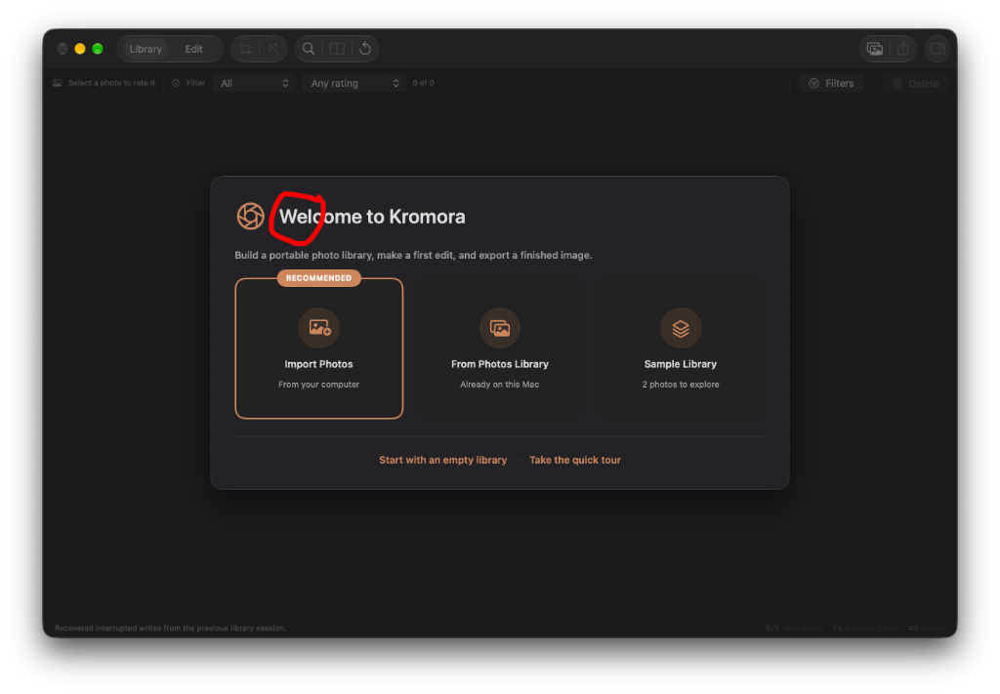

## Objective

Replace the aperture symbol beside "Welcome to Kromora" with the product app icon.

## Context

The first-run welcome sheet (`WelcomeView` in `Sources/KromoraKit/Views/OnboardingViews.swift`) draws an SF Symbol, `camera.aperture`, at 36pt in the accent color next to the large title. That glyph is the mark circled in the attached screenshot. The choice cards under the title (Import Photos, From Photos Library, Sample Library) keep their own symbols.

The product icon is `Kromora.icon`, compiled as the application icon (`ASSETCATALOG_COMPILER_APPICON_NAME = Kromora`). `KromoraAboutView` already shows that icon with `Image(nsImage: NSApplication.shared.applicationIconImage)`. The welcome header should use the same image so the packaged app, the About window, and the Dock agree. Do not add a second icon asset, and do not change other `camera.aperture` uses (the Develop inspector tab and its tests).

Size the icon so it sits in the existing header row beside the large title. The About window uses 76pt; the current symbol is 36pt. Keep the title alignment, sheet width, copy, and actions as they are. Leave the icon decorative (`accessibilityHidden`).

`swift run` is an unpackaged launcher and may not carry `Kromora.icon`. The production Xcode app does. Using `NSApplication.shared.applicationIconImage` is the right source; a generic icon in the SwiftPM launcher is expected.

## Acceptance criteria

- [ ] The welcome header shows the product application icon in place of `camera.aperture`.
- [ ] The icon is `NSApplication.shared.applicationIconImage`, the same source the About window uses, and it is sized to sit beside the large title.
- [ ] The icon stays decorative (`accessibilityHidden`). Title, subtitle, choice cards, and the empty-library and tour actions are unchanged.
- [ ] Other `camera.aperture` uses, including the Develop inspector, stay as they are.
- [ ] A focused test asserts that `WelcomeView` uses the application icon image and no longer uses `camera.aperture` for the header.

## Implementation notes

Follow the About window's image treatment (`resizable`, high interpolation) at a size that matches this header rather than the About window's 76pt frame. A source-inspection assertion in the style of `KromoraAboutTests` is enough if a rendered welcome snapshot is not practical. `docs/ONBOARDING.md` does not describe this glyph, so it does not need an update.

### Comment — claude @ 2026-10-24T12:47:42.536Z

Welcome header now uses NSApplication.shared.applicationIconImage (56pt, resizable, high interpolation, accessibilityHidden) in Sources/KromoraKit/Views/OnboardingViews.swift. Added OnboardingTests.testWelcomeHeaderUsesApplicationIconInsteadOfApertureSymbol (source inspection). swift test --filter OnboardingTests: 5/5 pass. Develop inspector camera.aperture uses untouched.

## Agent log

- 2026-10-24T14:06:51.095Z: Verification report
Verdict: PASS
Acceptance criteria:
- [x] The welcome header shows the product application icon in place of camera.aperture. (pass) — WelcomeView now displays NSApplication.shared.applicationIconImage.
- [x] The icon uses the same application icon source as About and is sized to sit beside the large title. (pass) — The header uses a 56 pt resizable image with high interpolation, matching the About window treatment.
- [x] The icon is decorative and the title, subtitle, choice cards, empty-library action, and tour action are unchanged. (pass) — The image retains accessibilityHidden(true); the diff changes only the header image treatment.
- [x] Other camera.aperture uses, including the Develop inspector, remain unchanged. (pass) — The Develop inspector symbol and its corresponding test remain present; neither file is changed.
- [x] A focused test asserts the WelcomeView application icon source and removal of the aperture symbol from the header. (pass) — OnboardingTests.testWelcomeHeaderUsesApplicationIconInsteadOfApertureSymbol passes.
Checks run:
- swift test --filter OnboardingTests — passed (5 tests, 0 failures).
- git diff --check -- Sources/KromoraKit/Views/OnboardingViews.swift Tests/KromoraKitTests/OnboardingTests.swift — passed.
- rg -n camera.aperture Sources/KromoraKit Tests/KromoraKitTests — confirmed the Develop inspector and its test still use the symbol.
Findings:
- None
Fixes:
- None
Verification commits:
- None
Actor: codex
Resolved model: gpt-6-luna
Pickup session: 01MVMH204NITBCZB0E
Summary: Verified welcome header app icon replacement; focused onboarding tests passed.
