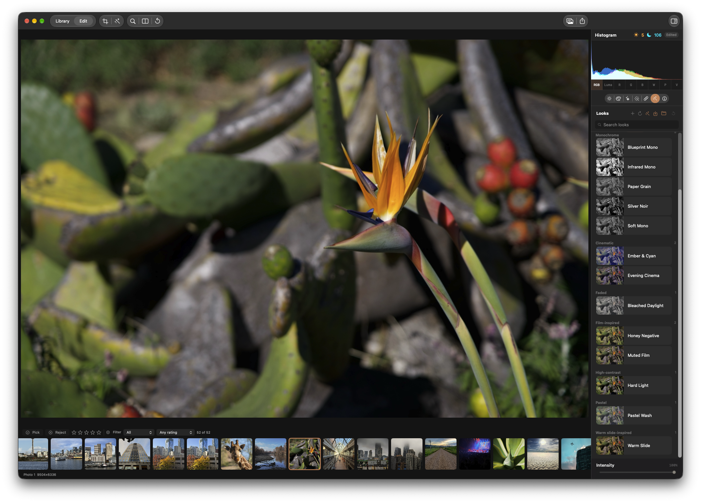

## Objective

Show the histogram's overexposure and underexposure indicators as percentages of the image's pixels instead of raw clipped-pixel counts.

## Context

The attached screenshot is visual context for the two indicators above the histogram. They currently display raw counts: the sun/highlights value counts pixels with any RGB channel at pure white, and the moon/shadows value counts pixels with all RGB channels at pure black. Keep those meanings and their existing placement; express each value as its share of all pixels represented by the current histogram.

## Acceptance criteria

- [ ] The sun/highlights indicator shows the percentage of histogram pixels where at least one RGB channel is 255; the moon/shadows indicator shows the percentage where all three RGB channels are 0. Count each pixel at most once per indicator.
- [ ] Compute each percentage from its clipped-pixel count divided by the total pixel count represented by the same rendered sample as the histogram. Show `%` rather than a raw count, keep the result between 0% and 100%, and retain enough precision that a nonzero share does not display as 0%.
- [ ] Refresh both percentages whenever the rendered image represented by the histogram changes.
- [ ] The indicators' help text and accessibility labels identify the percentage and whether it represents highlight clipping or crushed shadows.

## Implementation notes

Keep the change focused on the two existing histogram indicators and preserve their current clipping definitions. Keep the implementation within KromoraKit and follow the repository's macOS 26+, Apple Silicon, Swift 6, and no-third-party-dependency constraints.

## Agent log

<!-- Generated summaries only. Detailed activity lives in events.jsonl. -->

- 2026-10-24T18:30:09.964Z: Verification report
Verdict: PASS
Acceptance criteria:
- [x] The sun/highlights indicator shows the percentage of histogram pixels where at least one RGB channel is 255; the moon/shadows indicator shows the percentage where all three RGB channels are 0. Count each pixel at most once per indicator. (pass) — The RGBA8 tally increments each clipping count once per pixel using the required predicates. A mixed-pixel test confirms 3 of 5 highlight-clipped pixels and 1 of 5 crushed-shadow pixels.
- [x] Compute each percentage from its clipped-pixel count divided by the total pixel count represented by the same rendered sample as the histogram. Show % rather than a raw count, keep the result between 0% and 100%, and retain enough precision that a nonzero share does not display as 0%. (pass) — Fractions divide each clipped count by the sum of the same sample luma bins and clamp to 0...1. The inspector formats percentages to two decimal places and shows less than 0.01% for a nonzero share below that precision.
- [x] Refresh both percentages whenever the rendered image represented by the histogram changes. (pass) — The inspector derives both values directly from the current published HistogramData without separate cached percentage state.
- [x] The indicators help text and accessibility labels identify the percentage and whether it represents highlight clipping or crushed shadows. (pass) — The tooltip and accessibility label share the percentage text and explicit highlight-clipping or crushed-shadows description.
Checks run:
- swift test --filter HistogramTests — passed, 14 tests; final build completed without warnings.
- git diff --check and git diff --cached --check — passed.
Findings:
- None
Fixes:
- Renamed the inspector helper and comments to describe percentages rather than counts.
- Marked the pure percentage formatter nonisolated after the first build surfaced actor-isolation warnings in its synchronous test; the final build is warning-free.
- Added mixed-pixel fraction coverage for unique per-pixel counts and the matching histogram sample total.
Verification commits:
- 2565df5c5846a9fd498566a4f139cc91882f0726
Actor: codex
Resolved model: gpt-6-luna
Pickup session: 01MVMQE0GBGU4NLV0I
Summary: Counterpoint verification passed; focused histogram tests passed and the scoped verification commit was recorded.
