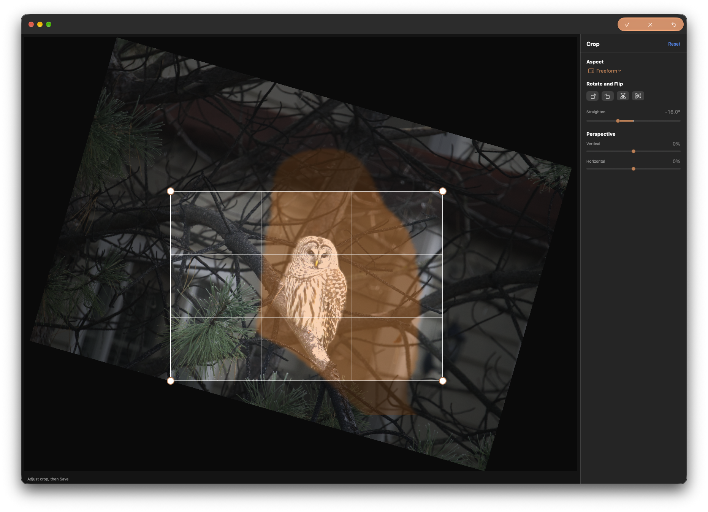
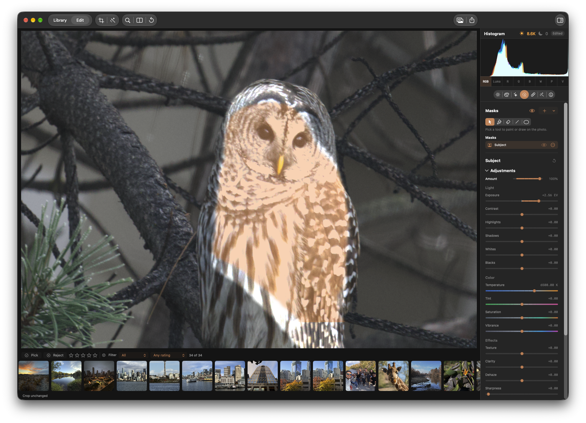

## Objective
Fix spatial alignment of smart masks with the photograph across cropping and rotation, both when a mask is created after the geometry edit and when an existing mask is followed by a geometry edit.

## Reported behavior and reproduction
1. Open a photograph with a clear subject in Edit. Crop and rotate/straighten it, then create a Subject mask. The mask presentation does not line up with the subject, and adjustments applied through the mask affect the wrong pixels.
2. On a photograph without those geometry edits, create a Subject mask first, then crop and rotate/straighten. The existing mask becomes misaligned with the image. The attached screenshots illustrate the crop/straighten view and the resulting misaligned exposure adjustment on an owl.

Subject is confirmed by the report; investigate other smart mask types for the same issue rather than assuming they are affected. The exact cause and any role of crop versus rotation alone are not yet established.

## Expected behavior / acceptance criteria
- [ ] Subject mask coverage stays registered to the same image content in both the visible mask presentation and the actual adjustment, whether crop/rotation precedes or follows mask creation. Changing geometry again and resetting it must also preserve alignment.
- [ ] Investigate other available smart mask types and fix any equivalent alignment defects found; document the scope checked. Preserve correct behavior for existing mask types and editing workflows.
- [ ] Verify crop and straighten/rotation independently and together, with representative nontrivial geometry and image orientations. Check preview and exported output, including saved/reopened edits, so the visible overlay and rendered adjustment agree with the subject.
- [ ] Add focused regression coverage that exercises both edit orders and checks spatial placement of mask coverage and applied pixels against the image; run the applicable repository test gates.

## Starting context
Inspect the smart-mask generation, mask overlay/presentation, local mask rendering, and crop/rotation coordinate transforms as a single pipeline. Useful starting points include `Sources/KromoraKit/Models/LocalMaskRendering.swift`, `Sources/KromoraKit/Models/RenderEngine.swift`, `Sources/KromoraKit/Models/MaskDiscoveryGeometry.swift`, and `Tests/KromoraKitTests/SmartMaskTests.swift` and `LocalMaskRenderingTests.swift`. These are leads, not a prescribed cause or implementation. KRMA-914 concerns Smart Mask Discovery presentation geometry; its previous coverage does not establish correctness of this reported editing/rendering defect.

### Comment — claude @ 2026-10-29T23:46:10.448Z

Root cause: source-derived mattes (Subject/Foreground/Background/Person/Face, luminance, colour, depth) are computed in the EXIF-oriented source frame, but RenderEngine stretched them over the post-geometry frame (and the masking overlay stretched them over the unrotated source frame). Quarter-turn, flip, straighten and perspective therefore misplaced them; crop alone was already correct. Fix: MaskSourceGeometry resolves these mattes over the oriented source frame and LocalMaskRenderer.geometryImage carries them through the same applyingRotation/applyingGeometry as the photo; payloads stay geometry-independent so geometry edits reuse cached mattes. The overlay request/task id carry the geometry and PreviewView passes the post-geometry size to MaskCanvasOverlay. Scope checked: brush/linear/radial are authored in the post-geometry frame and are unchanged; luminance/colour share the fix; depth is unavailable. Tests: MaskGeometryAlignmentTests (6 geometries, preview+export+overlay, fail without the fix); test-affected (247) and ci-tests serial (763) pass. Not verified: saved/reopened edits are covered implicitly (recipe unchanged, geometry read from the document); no interactive UI check was possible in this run.

## Agent log

- 2026-10-30T00:09:21.767Z: Verification report
Verdict: PASS
Acceptance criteria:
- [x] Subject mask coverage remains registered through crop and rotation whether geometry changes before or after mask creation; repeated geometry changes and reset preserve alignment. (pass) — MaskGeometryAlignmentTests verifies preview and export pixels across six geometry cases. The mask-first case changes geometry after creating the mask, JSON round-trips the document, verifies both render qualities after reopen, then resets geometry and verifies the mask again. Crop-clipped overlay coverage is checked against the visible photograph.
- [x] Investigate other available smart mask types and fix equivalent alignment defects while preserving existing mask types and workflows. (pass) — The shared source-derived path covers semantic Subject, Foreground, Background, Person, and Face masks plus luminance and color ranges. Brush, linear, and radial masks remain authored in the post-geometry frame. Depth masks are currently unavailable.
- [x] Verify crop and straighten or rotation independently and together with nontrivial geometry and image orientations; compare preview, export, saved/reopened edits, overlay, and rendered adjustment. (pass) — Coverage includes crop-only, straighten, quarter-turn, combined quarter-turn plus crop and straighten, half-turn, flips, and perspective. Preview/export adjustment pixels and overlay coverage are compared to the synthetic photograph; the persisted document round-trip and geometry reset are explicitly tested.
- [x] Add focused regression coverage for both edit orders and spatial placement; run applicable repository test gates. (pass) — Five MaskGeometryAlignmentTests cover geometry-first, mask-first, overlay, persistence, and reset. A rotation-size review defect in overlay wiring was also corrected.
Checks run:
- scripts/test-affected.sh — exit 0; 247 tests executed.
- scripts/test-affected.sh MaskGeometryAlignmentTests — exit 0; 5 tests executed.
- scripts/ci-tests.sh fast — exit 0; 2,166 tests executed.
- scripts/ci-tests.sh serial — exit 0; 763 tests executed, 1 skipped.
- git diff --cached --check — exit 0.
Findings:
- None
Fixes:
- Changed mask overlay and discovery geometry mapping to start from maskingSource.nativeExtent. AppViewModel.sourceSize is already quarter-turned after rotation, so applying document rotation to it again used the wrong frame.
- Added regression coverage for cropped overlay clipping, document save/reopen, mask creation before geometry edits, and geometry reset.
Verification commits:
- ed91de9912ef032c427087bf6b65e600fdfab1c9
Actor: codex
Resolved model: gpt-6-luna
Pickup session: 01MVU6ZG3I9D7X3DWA
Summary: Verification passed: source-derived masks remain aligned through geometry; required regression and CI lanes passed.
