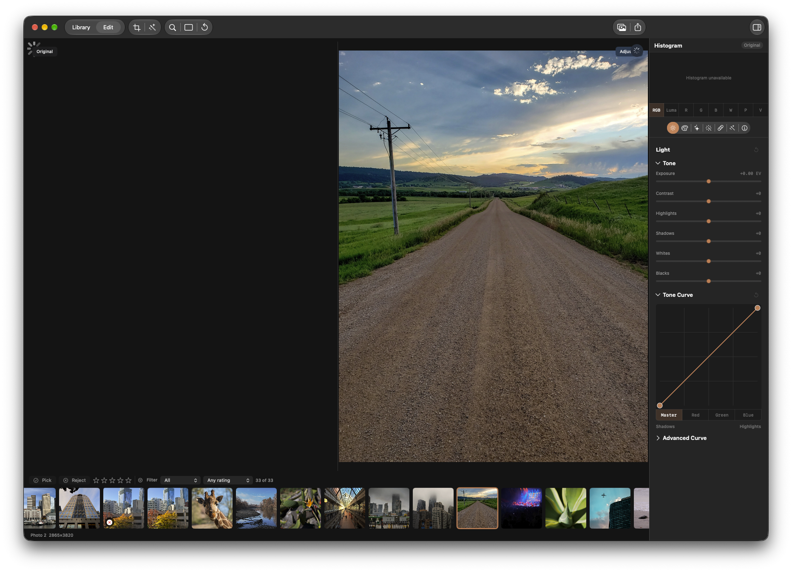

## Problem and reproduction
With side-by-side comparison enabled, select a photo in Library and enter Edit. The adjusted image appears nearly instantly, but the Original pane remains blank with a spinner for a prolonged period. The attached screenshot shows the observed state. The exact delay and cause have not been measured.

## Acceptance criteria
- [ ] Investigate and correct the delayed Original presentation on Library-to-Edit entry with side-by-side enabled. The Original should become visible promptly alongside the adjusted image, without a prolonged blank spinner, while retaining correct original rendering.
- [ ] Verify entering Edit, switching photos and leaving/re-entering Edit with comparison enabled; avoid stale or wrong-photo images, and preserve adjusted-preview responsiveness and other comparison modes.
- [ ] Add focused regression coverage for the relevant loading and presentation behavior. Record the cause and appropriate before/after evidence without asserting an unmeasured latency target; run applicable repository checks.

Review the previous KRMA-158 missing Original issue and current comparison and preview coordination as starting context. Follow the repository restrictions on display-bound benchmarks.

### Comment — codex @ 2026-10-30T00:31:56.619Z

Additional user observation: if the window is defocused while the Original pane is stuck, the image does not load during the entire defocused period; it loads after the window is refocused. Investigate window activation and presentation/invalidation as possible factors, without assuming the underlying cause. Include defocus and refocus in regression verification.

### Comment — claude @ 2026-10-30T00:32:55.906Z

Implemented. Cause (code analysis, latency not measured): the Original render was a support-priority job on the single-concurrency editor lane; entering Edit queued the settled Adjusted render at active-editor priority, which evicted the queued Original and ran first, leaving the pane blank until it published. Fix: Sources/KromoraKit/Models/ImageWorkScheduler.swift adds a pinned job flag (survives active-editor eviction, starts ahead of queued jobs); Sources/KromoraKit/ViewModels/PreviewAdmissionCoordinator.swift pins the Original only when side-by-side is visible and no Original is displayed, so photo switches and other modes are unchanged and the existing asset/revision guards still reject stale images. A render already running is not preempted, so a remaining wait behind it is possible and unmeasured. Test: ImageWorkSchedulerTests/testPinnedComparisonSurvivesActiveEditorAndStartsFirst (before: Original evicted/ordered after settled; after: runs first). Ran scripts/test-affected.sh ImageWorkSchedulerTests PreviewAdmissionCoordinatorTests: 36 pass. No display-bound capture run, per repo policy; the Library-to-Edit visual check was not performed.

## Agent log

- 2026-10-30T00:37:46.412Z: Verification report
Verdict: BLOCKER
Acceptance criteria:
- [x] On Library-to-Edit entry with visible side-by-side and an empty Original pane, schedule the baseline ahead of queued settled Adjusted work while preserving the existing source and revision guards. (pass) — Code inspection confirms the Original is pinned only for a visible empty side-by-side pane and the current asset, source revision, comparison revision, navigation, and source checks remain in the render path. ImageWorkSchedulerTests/testPinnedComparisonSurvivesActiveEditorAndStartsFirst and PreviewAdmissionCoordinatorTests/testVisibleEmptyOriginalIsPinnedAheadOfSettledAdjustedPreview exercise queue retention and coordinator wiring.
- [ ] Verify entering Edit, switching photos, leaving and re-entering Edit, defocusing and refocusing the window; confirm correct-photo Original presentation, adjusted-preview responsiveness, and other comparison modes. (fail) — No native UI lifecycle run or focus/presentation regression test was performed. The implementation comment reports that the Original appeared after refocus, and the new tests establish scheduler ordering only; they do not establish whether image completion/presentation depends on window activation or verify photo-switch and re-entry behavior at the presentation boundary.
- [x] Add focused regression coverage, record cause and before/after evidence without an unmeasured latency target, and run applicable repository checks. (pass) — Added a coordinator-level test that demonstrates the visible empty Original request is admitted ahead of queued settled Adjusted work. Cause remains a code-analysis finding, not a measured latency claim. The original 36-test affected run passed; after adding the coordinator test the affected command first exposed a gate-registration race in that test, and the isolated corrected test passed.
Checks run:
- scripts/test-affected.sh ImageWorkSchedulerTests PreviewAdmissionCoordinatorTests — exit 0; 36 tests passed before adding the coordinator wiring test.
- scripts/test-affected.sh ImageWorkSchedulerTests PreviewAdmissionCoordinatorTests — exit 1 after adding the coordinator test; the new test timed out because its gate was released before waiter registration.
- scripts/test-affected.sh PreviewAdmissionCoordinatorTests/testVisibleEmptyOriginalIsPinnedAheadOfSettledAdjustedPreview — exit 0 after correcting gate synchronization; 1 test passed.
- git diff --check — exit 0.
Findings:
- blocker: The reported defocus/refocus symptom and the required photo-switch and Edit re-entry behavior remain unverified at the UI/presentation boundary. Scheduler ordering tests do not establish whether the baseline finishes and invalidates the visible surface while the window is inactive.
Fixes:
- Added PreviewAdmissionCoordinatorTests/testVisibleEmptyOriginalIsPinnedAheadOfSettledAdjustedPreview to verify the coordinator pins an empty visible side-by-side Original ahead of queued settled Adjusted work.
Verification commits:
- 3b28892d
Actor: codex
Resolved model: gpt-6-luna
Pickup session: 01MVU8NKN33I4WRGZV
Summary: Scheduler and coordinator ordering checks pass, but the explicitly requested window focus and photo lifecycle behavior remains unverified; created an urgent child verification dependency.

- 2026-10-30T14:08:22.875Z: Verification report
Verdict: PASS
Acceptance criteria:
- [x] Correct delayed Original scheduling on Library-to-Edit entry with visible side-by-side while retaining source and revision guards. (pass) — Pinned admission is limited to a visible empty Original pane; existing asset, source, comparison, navigation, and source checks remain in place. Scheduler and coordinator regressions passed. Cause is code-analysis evidence; no latency target is asserted.
- [x] Verify photo entry, switching, Edit re-entry, and focus/presentation behavior; preserve correct-photo panes, Adjusted responsiveness, and other comparison modes. (pass) — OriginalPresentationOrderingTests uses per-photo pixels through Library/Edit navigation and switch/re-entry, with side-by-side toggles. Per the owner-approved KRMA-1142 amendment, the focus gate is the headless skipped-drawable/real-presentation policy check; real compositor delivery remains a manual release-qualification check.
- [x] Add focused regression coverage, record cause and before/after evidence without an unmeasured latency target, and run applicable checks. (pass) — Focused lifecycle, surface, comparison, navigation, scheduler, and coordinator coverage passed; the issue record captures the before/after queue-order evidence.
Checks run:
- scripts/test-affected.sh OriginalPresentationOrderingTests OriginalPresentationLifecycleTests PreviewSurfaceTests ComparisonModeTests WorkspaceNavigationTests — exit 0; 93 tests passed.
- scripts/test-affected.sh ImageWorkSchedulerTests/testPinnedComparisonSurvivesActiveEditorAndStartsFirst PreviewAdmissionCoordinatorTests/testVisibleEmptyOriginalIsPinnedAheadOfSettledAdjustedPreview — exit 0; 2 tests passed.
- git diff --check — exit 0.
- Source review of ImageWorkScheduler, PreviewAdmissionCoordinator, PreviewPublicationCoordinator, PreviewSurface, and OriginalPresentationOrderingTests.
Findings:
- None
Fixes:
- None
Verification commits:
- None
Actor: codex
Resolved model: gpt-6-luna
Pickup session: 01MVV1OZ52VKK96PJZ
Summary: Pass: focused lifecycle, presentation, scheduler, and comparison verification passed; compositor delivery remains a manual release-qualification check per KRMA-1142.
