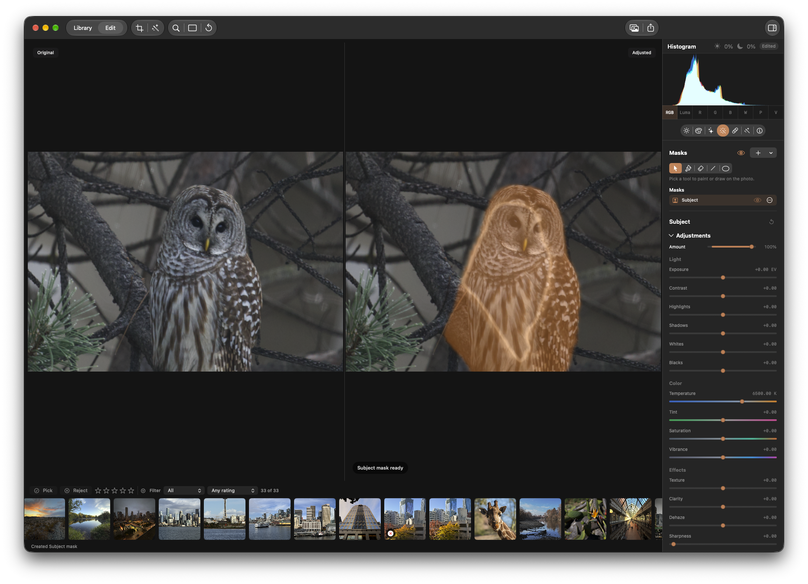

## Problem
Follow-up to KRMA-1146: the user reports that the mask alignment fix mostly succeeded, but during the smart mask discovery animation the bright revealed region still has the wrong shape or alignment. Reproduce with a cropped and rotated/straightened image and a Subject mask; compare the animated bright region to the actual subject and the finished mask. The screenshot shows the reported owl scenario. Do not assume the screenshot alone captures the problematic animation frame.

## Acceptance criteria
- [ ] The discovery animation's bright mask-shaped reveal follows the actual returned mask and photograph through crop and rotation/straighten, including combined geometry, and transitions consistently into the finished mask presentation.
- [ ] Check other available smart masks for the same issue, and verify normal geometry and side-by-side presentation remain correct. Document the scope checked.
- [ ] Add focused regression coverage for the animation's mask-to-canvas mapping with nontrivial geometry, including crop and rotation together; run applicable repository checks and document any remaining visual verification limitations.

## Context
KRMA-1146 corrected source-derived mask rendering and overlay geometry; review that fix and its verification notes. KRMA-914 covers the Smart Mask Discovery interaction. Investigate `MaskDiscoveryGeometry`, `MaskDiscoveryOverlay`, and their geometry inputs alongside the corrected mask path; the cause is not yet established.

## Agent log

- 2026-10-30T13:55:26.220Z: Verification report
Verdict: PASS
Acceptance criteria:
- [x] The discovery animation's bright mask-shaped reveal follows the returned mask and photograph through crop and rotation/straighten, including combined geometry, then transitions consistently into the finished mask presentation. (pass) — Reviewed the discovery overlay's returned-mask raster path and shader sampling. MaskDiscoveryGeometryOracleTests compares the lookup with the real Core Image geometry graph at 216 points across neutral, crop, straighten, perspective, flips, and all quarter turns. The test includes combined crop and rotation. No live replay of the attached owl frame was performed.
- [x] Check other available smart masks for the same issue, and verify normal geometry and side-by-side presentation remain correct. Document the scope checked. (pass) — Subject, Person, Face, Foreground, and Background creation all use the shared returned-mask discovery path, so the geometry mapping is kind-independent. The oracle includes neutral geometry. PreviewView keeps the discovery overlay off the side-by-side Original pane and on the adjusted pane; the fast lane's ComparisonModeTests passed.
- [x] Add focused regression coverage for animation mask-to-canvas mapping with nontrivial geometry, including crop and rotation together; run applicable checks and document remaining visual verification limitations. (pass) — Added MaskDiscoveryGeometryOracleTests, with 216 sampled mapping comparisons across crop, straighten, perspective, flips, and quarter turns. The attached owl scenario was not replayed in motion; verification was by the Core Image geometry oracle and code-path review.
Checks run:
- scripts/test-affected.sh --base 48278ba0^ — exit 0; 4 tests passed (GeometryPointMappingTests: 3, MaskDiscoveryGeometryOracleTests: 1).
- scripts/ci-tests.sh fast — first invocation exited 1, but the failing method was not retained in the console capture; a complete rerun exited 0 with all 2,178 tests. The initial failure did not reproduce.
- git show --check --oneline 48278ba0 — exit 0.
Findings:
- None
Fixes:
- Commit 48278ba0 updates GeometryPointMapping to match CIStraightenFilter's fill scale and the renderer's clamped keystone corners, and adds a Core Image oracle regression test.
Verification commits:
- None
Actor: codex
Resolved model: gpt-6-luna
Pickup session: 01MVV0YFO6F4XAJ0Q1
Summary: Verification passed: crop and rotation discovery mapping matches the Core Image geometry oracle; focused and fast checks passed on final runs.
