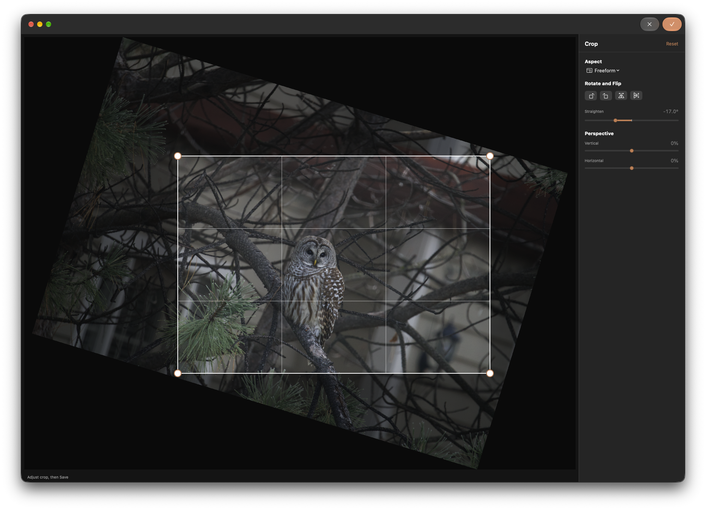
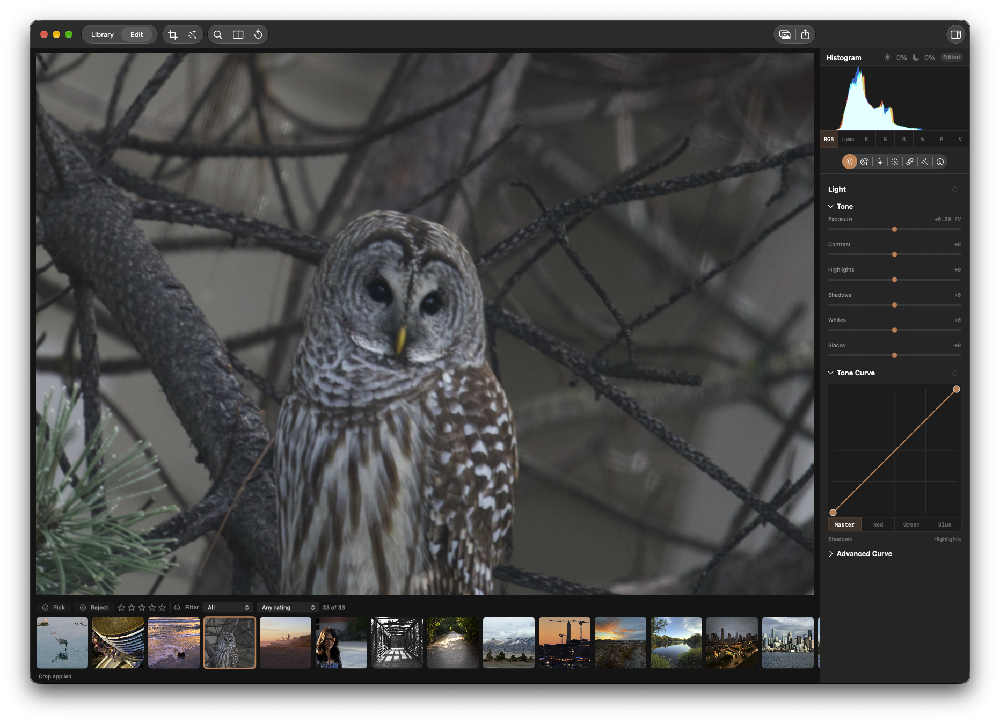

## Problem
After accepting a crop on a straightened photograph, the editor displays a substantially tighter composition than the rectangle outlined in crop view. The user reports being at 100% zoom and expects the same image content as the selected crop. Rotation or straightening appears necessary to trigger the effect; the example uses -17° straighten, freeform aspect, and zero perspective. The cause is not yet established.

## Reproduction
1. Open a photo in Edit and enter Crop.
2. Straighten the photo (the example uses -17°), then set a freeform crop around recognizable landmarks.
3. Accept the crop and compare the editor at 100% zoom with the crop rectangle. In the supplied example the owl and surrounding branches appear much more tightly cropped after acceptance.
4. Compare with an unrotated crop to establish the scope of the trigger.

## Acceptance criteria
- [ ] After accepting a straightened crop, the displayed image represents the same image content and boundaries selected in crop view; distinguish actual crop geometry from viewport zoom when verifying.
- [ ] Check crop-only and rotated/straightened cases, including non-centered crops and representative angles; preserve correct behavior for other crop geometry.
- [ ] Verify the applied result and exported output agree with the selected crop, including after saving and reopening edits.
- [ ] Add focused regression coverage for crop-view-to-render geometry and run applicable repository checks.

## Context
The attached screenshots show the crop selection before acceptance and the resulting editor view. Investigate the crop preview, straighten transform, crop coordinate mapping, and presentation zoom together without assuming a root cause. KRMA-1146 and KRMA-1143 address mask geometry after crop and rotation, not this reported crop mismatch.

### Comment — claude @ 2026-10-31T00:27:21.132Z

Root cause: applyingGeometry used CIStraightenFilter, which keeps the source extent, clips corners and zooms pixels; the result was then non-uniformly stretched onto the rotated AABB, so the applied image was tighter than the crop view. Fix: centered affine rotation cropped to the analytic AABB in Sources/KromoraKit/Models/RenderPipeline.swift; removed the compensating fill scale in Sources/KromoraKit/Models/GeometryPointMapping.swift. Added GeometryPointMappingTests.testRenderedStraightenMatchesPointMapping. Affected suites and ci-tests.sh serial (763 tests) pass. Export and preview share the same graph. Changes uncommitted.

## Agent log

- 2026-10-31T00:39:56.814Z: Verification report
Verdict: PASS
Acceptance criteria:
- [x] After accepting a straightened crop, the displayed image represents the same image content and boundaries selected in crop view; distinguish actual crop geometry from viewport zoom when verifying. (pass) — The added render regression maps a non-centered marker through -17 degree straighten geometry and matches GeometryPointMapping within 0.01 normalized coordinates while checking the analytic rotated AABB. The affine path removes the filter zoom and anisotropic fill; geometry is verified independently of viewport presentation zoom.
- [x] Check crop-only and rotated/straightened cases, including non-centered crops and representative angles; preserve correct behavior for other crop geometry. (pass) — CropPipelineTests covers straighten angles -45, -30, 15, and 45 degrees plus combined flip and perspective. MaskGeometryAlignmentTests covers non-centered crop-only, quarter-turn with straighten and crop, and half-turn with flip and straighten; all passed.
- [x] Verify the applied result and exported output agree with the selected crop, including after saving and reopening edits. (pass) — CropPipelineTests confirms preview raster and PNG export parity for straightened crops across representative angles. EditedThumbnailCoordinatorTests verifies package-saved crop and rotation are restored after reopening, and MaskGeometryAlignmentTests verifies reopened geometry through preview and export.
- [x] Add focused regression coverage for crop-view-to-render geometry and run applicable repository checks. (pass) — Added GeometryPointMappingTests.testRenderedStraightenMatchesPointMapping. The affected suites, render/UI serial lane, and saved/reopened geometry suite all passed.
Checks run:
- scripts/test-affected.sh — exit 0; 54 tests across GeometryPointMappingTests and RenderPipelineTests.
- scripts/ci-tests.sh serial — exit 0; 763 tests, 1 skipped, 0 failures.
- scripts/test-affected.sh MaskGeometryAlignmentTests — exit 0; 5 tests.
- git diff --check — exit 0.
- Independent review of Sources/KromoraKit/Models/RenderPipeline.swift, Sources/KromoraKit/Models/GeometryPointMapping.swift, and Tests/KromoraKitTests/GeometryPointMappingTests.swift.
Findings:
- The renderer pixel output changed without a pixel epoch bump, which could keep previously rendered frames current. Fixed during verification by advancing RenderPipeline.pixelEpoch from 37 to 38.
Fixes:
- Advanced RenderPipeline.pixelEpoch to 38 so cached and persisted frames from the previous straighten geometry are refined against the corrected affine output.
Verification commits:
- None
Actor: codex
Resolved model: gpt-6-luna
Pickup session: 01MVVNW8C1QT05OIIQ
Summary: Passed independent verification. Straighten geometry now matches the crop mapping and cached frames are invalidated with pixel epoch 38.
