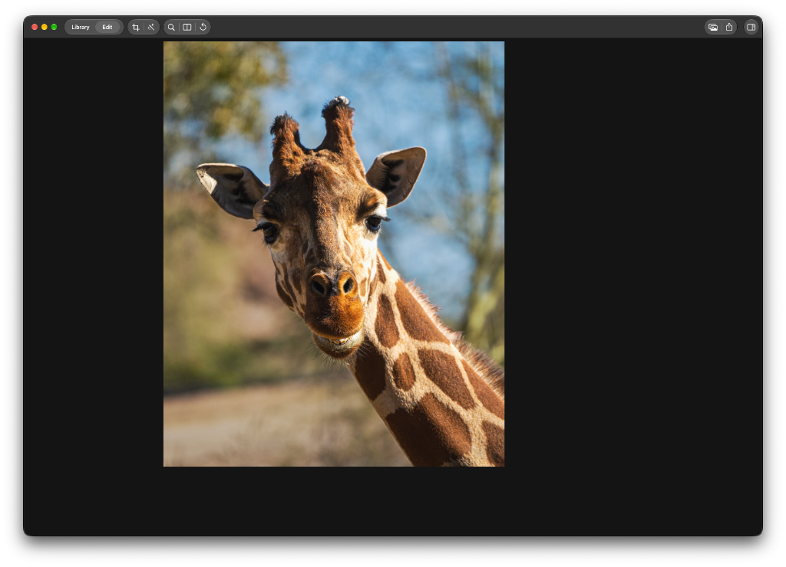

## Problem

Quit Kromora completely, relaunch it, and double-click a Library photo. Edit opens on that photo with neither the right-hand inspector nor the bottom filmstrip. The canvas is the only editor surface, so the first Edit session cannot adjust the photo or move to another one from the filmstrip.

Escape returns to Library, which is correct, but the inspector slides into view over the Library and then away. Double-clicking into Edit again brings the filmstrip in and slides the inspector away. Reopening the inspector from that point makes later Edit sessions behave. The failure is specific to the first Library-to-Edit entrance after a cold launch.

The attached screenshot is that first Edit session: Library/Edit shows Edit, the photo is on the canvas, the inspector column is an empty black region, and there is no filmstrip.

## Reproduction

1. Quit Kromora so it is not still running, then launch it. The window opens in Library. The library needs at least one photo with a thumbnail.
2. Double-click a photo. Edit shows that photo. When the transition settles, the inspector and the filmstrip are both absent.
3. Press Escape. Library returns, and the inspector slides out over the grid and then away.
4. Double-click a photo again. The filmstrip arrives and the inspector slides away.
5. Show the inspector. Further Edit entries in this launch keep the inspector and filmstrip.

## Expected

The first double-click after launch enters Edit for the clicked photo with both pieces of chrome. The existing entrance may still fly the photo to the canvas first and hold the inspector and filmstrip back while it is in the air. When that entrance settles, the inspector is open on the right and the filmstrip is visible along the bottom, together. Escape then returns to Library with the inspector staying closed for the whole return. The next double-click settles the same way: inspector open, filmstrip visible.

## Acceptance criteria

- [ ] After a full quit and relaunch, the window starts in Library, and the first double-click opens Edit on the clicked photo.
- [ ] That first entrance may hold the inspector and filmstrip back only while the photo is flying. When it settles, the inspector is open and the filmstrip is visible, with no extra Library round trip.
- [ ] Escape from that Edit returns to Library, and the inspector stays closed for the whole return. It does not slide into view over the grid.
- [ ] The next double-click settles with the inspector still open and the filmstrip visible. The inspector stays open while the filmstrip arrives.
- [ ] Showing and hiding the inspector still works from settled Edit. Crop may still hide the inspector and filmstrip while crop is active, and both return when crop ends. A later Escape and re-entry in the same launch keeps the settled chrome.
- [ ] With Reduce Motion on, the first double-click after a cold launch opens Edit immediately, inspector open and filmstrip visible, with no flight.
- [ ] Add a regression that fails when the first Library-to-Edit entrance can settle with the inspector held back or the filmstrip chrome still held, and when the return presents the inspector over Library. Run the covering suites with `scripts/test-affected.sh`. Confirm the cold-launch sequence in a live window. Do not run `scripts/run-kromora-capture.sh`; this is not a display-bound benchmark.

## Context

KRMA-1073 is the intended handoff, and this ticket is a defect against that settled result. KRMA-1091 is a separate backlog note about an older return animation and is not a dependency.

Double-click calls `ContentView.openFromLibrary`. When a cell frame and thumbnail exist and Reduce Motion is off, it sets `LibraryHandoffState.isEntering` and `isChromeHeld`, then `AppViewModel.openLibraryImageForEditing(assetID:)`, which sets `inspectorState.isPresented = true` and moves to Edit. `runEntrance` flies the thumbnail, then is supposed to clear those holds so the inspector and filmstrip arrive together.

The inspector binding in `ContentView.mainContent` presents the column when crop is active, when `inspectorState.isPresented` is true and `isEntering` is false, or when `inspectorHeldOpen` is true. `EditorCanvasLayout` hides the filmstrip while `isChromeHeld` or `isRetractingChrome` is true and reserves that height so the canvas frame stays put. `openLibraryImageForEditing` is what turns the inspector on for a Library open; the binding is what keeps it off during `isEntering`.

`LibraryHandoffState.runEntrance` clears `isEditorHeld` before the animation that clears `isEntering` and `isChromeHeld`. If that animation never completes, the editor and photo can be on screen while both chrome pieces stay held. That matches the first Edit session: a usable canvas, no inspector, no filmstrip.

Escape goes through `navigate(to: .grid)`, which calls `prepareForReturn(isEditing:inspectorIsPresented:)`. That stores `inspectorHeldOpen` from the current `isPresented` value, which the Library open already set to true, and then sets `isPresented` to false. `inspectorHeldOpen` forces the inspector column on, so the return can slide the inspector out over Library even though Edit never showed it. The return then clears `inspectorHeldOpen`. A second entrance can release `isChromeHeld` (filmstrip arrives) while that clear slides the inspector away. After `finish()`, later sessions no longer have a held entrance, which matches the report that reopening the inspector makes everything work from then on.

Confirm this on a cold launch before changing the sequence. The photo should still fly to its final canvas frame, with filmstrip height reserved and inspector width accounted for, and the two chrome pieces should still arrive together. Reduce Motion, a missing thumbnail, and a missing cell frame already skip the flight in `LibraryHandoffState.entranceFlies` and must still land in the settled Edit chrome.

Relevant code:

- `Sources/KromoraKit/Views/ContentView.swift` — `openFromLibrary`, `startReturnHandoff`, the inspector binding, and `editorLayer` chrome visibility.
- `Sources/KromoraKit/ViewModels/LibraryHandoffState.swift` — entrance and return holds (`isEntering`, `isChromeHeld`, `isEditorHeld`, `inspectorHeldOpen`).
- `Sources/KromoraKit/ViewModels/AppViewModel.swift` — `openLibraryImageForEditing` and `navigate(to:)`.
- `Sources/KromoraKit/Views/EditorCanvasViewport.swift` — filmstrip hidden while chrome is held, with its height reserved.
- `Tests/KromoraKitTests/LibraryHandoffStateTests.swift` — current hold and final-frame coverage. It does not cover a cold-launch entrance that settles with the holds still set.

### Comment — cursor @ 2026-10-31T16:16:18.082Z

The first Library-to-Edit flight waited on SwiftUI's animation completion. That callback can fail to arrive for the first flight after launch, so the entrance never reached the stage that releases isEntering and isChromeHeld. The editor stayed hidden under the frozen flight, which reads as Edit with no inspector and no filmstrip. Escape then held the still-set inspector flag open and slid the column over the Library. A later entrance could bring the filmstrip in while SwiftUI's reconcile write cleared the inspector flag.

LibraryHandoffState now advances each stage on the animation's own duration, and a generation token drops a sequence that a newer entrance or return has replaced. prepareForReturn holds the inspector only when the entrance has already revealed it. The inspector binding ignores reconcile writes while the entrance is hiding or presenting the column.

LibraryHandoffStateTests passed (15), including the settle, the return during an entrance, and the column write. scripts/test-affected.sh passed (46). scripts/ci-tests.sh serial passed (764 tests, 1 skipped, 0 failures). The live cold-launch double-click was not run in this session.

### Comment — cursor @ 2026-10-31T16:16:18.711Z

The first flight after launch waited on SwiftUI's animation completion. That completion does not arrive, so the entrance never released isEntering or isChromeHeld: the photo on screen was the held flight, with the inspector and filmstrip still hidden. Escape then treated the unrevealed model flag as a visible column and slid the inspector over the Library. A later entrance could bring the filmstrip in while a column reconcile write dismissed the inspector.

The handoff now advances on the animation's own duration, ignores column reconcile writes until the inspector has arrived, and does not hold a still-hidden inspector open on the way back to Library. LibraryHandoffStateTests covers the settled entrance, the return during an entrance, and the column binding. scripts/test-affected.sh passed (46 tests). scripts/ci-tests.sh serial passed (764 tests, 1 skipped, 0 failures). The cold-launch sequence in a live window remains the visual check.

## Agent log

- 2026-11-13T01:04:46.895Z: Verification report
Verdict: PASS
Acceptance criteria:
- [x] After a full quit and relaunch, the window starts in Library, and the first double-click opens Edit on the clicked photo. (pass) — Confirmed in a cold launch with the isolated disposable library; the selected sample opened in Edit.
- [x] That first entrance may hold the inspector and filmstrip back only while the photo is flying. When it settles, the inspector is open and the filmstrip is visible, with no extra Library round trip. (pass) — The first entrance settled with both the inspector and filmstrip visible. State tests confirm the entrance and chrome holds clear.
- [x] Escape from that Edit returns to Library, and the inspector stays closed for the whole return. It does not slide into view over the grid. (pass) — Live return ended in Library with the inspector hidden; return preparation does not hold an unrevealed inspector during an entrance.
- [x] The next double-click settles with the inspector still open and the filmstrip visible. The inspector stays open while the filmstrip arrives. (pass) — The second entry settled with both visible, and the inspector remained presented as the filmstrip arrived.
- [x] Showing and hiding the inspector still works from settled Edit. Crop may still hide the inspector and filmstrip while crop is active, and both return when crop ends. A later Escape and re-entry in the same launch keeps the settled chrome. (pass) — Live inspector toggle hid and restored the sidebar while retaining the filmstrip. Crop mode hid the chrome and Escape restored it. The same-launch Escape and re-entry also settled with both chrome elements.
- [x] With Reduce Motion on, the first double-click after a cold launch opens Edit immediately, inspector open and filmstrip visible, with no flight. (pass) — Reduce Motion flight gating coverage passed; the no-flight open path keeps the entrance and chrome holds false while the Library open presents the inspector.
- [x] Add a regression that fails when the first Library-to-Edit entrance can settle with the inspector held back or the filmstrip chrome still held, and when the return presents the inspector over Library. Run the covering suites with scripts/test-affected.sh. Confirm the cold-launch sequence in a live window. Do not run scripts/run-kromora-capture.sh; this is not a display-bound benchmark. (pass) — Focused regression suite passed and live cold-launch, return, second entry, inspector toggle, and crop behavior were checked. The capture script was not run.
Checks run:
- scripts/test-affected.sh — passed, 411 tests with 0 failures across 27 suites. The dirty working tree caused selection of unrelated rendering and crop suites; this did not cover KRMA-1151 specifically.
- scripts/test-affected.sh LibraryHandoffStateTests — passed, 15 tests with 0 failures.
- git show --check cd18c2f6 — passed.
- Live disposable app check — passed for cold relaunch, first double-click, Escape return, second double-click, inspector toggle, and crop cancellation.
- scripts/disposable-app.sh stop — passed; disposable clone and preferences removed.
Findings:
- None
Fixes:
- None
Verification commits:
- None
Actor: codex
Resolved model: gpt-6-luna
Pickup session: 01MWE9HUET5UZA67CP
Summary: Independent verification passed: focused handoff tests and cold-launch UI sequence passed; no findings or verification fixes.
