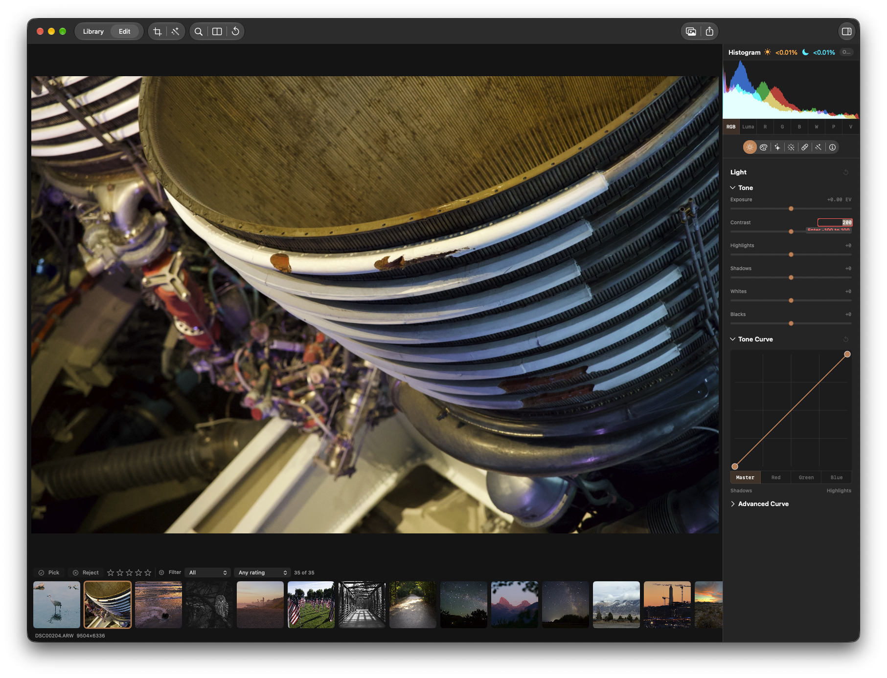

## Objective

Make numeric range validation errors in the Edit inspector fully readable and clearly associated with their control.

## Context

The supplied screenshot shows Edit → Light → Tone with the Contrast value set to `200`. The control's supported range is `-100` to `100`, and a red range error appears beneath the field, but the message is clipped by the surrounding inspector layout and is difficult to read.

## Acceptance criteria

- [ ] Entering an out-of-range Contrast value such as `200` displays the complete range error without clipping or overlap at the inspector width shown in the screenshot.
- [ ] The error is legible at normal window scale and clearly associated with the Contrast field.
- [ ] Valid values and the existing range validation behavior continue to work.
- [ ] Validation feedback for other numeric controls using the same UI is checked and remains readable.

## Reproduction

1. Open a photo in Edit.
2. In Light → Tone, enter `200` in the Contrast value field.
3. Observe the red range error below the field; it is clipped and unreadable in the supplied screenshot.

## Verification

Exercise the invalid Contrast value at the screenshot's inspector width and confirm the full error remains visible. Check other numeric controls that share this validation presentation.

### Comment — codex @ 2026-11-12T23:54:30.490Z

Counterpoint review: the localized `SliderValueField` change reserves a 16 pt line below the editing field for the inline error, and the shared component is used by Light, Color, Effects, Crop, Develop, Look, and Masking controls. Checks passed: `scripts/test-affected.sh SliderValueEntryTests` (8 tests), Xcode Debug app build, and `git diff --check`. I could not complete the required visual reproduction: both installed and freshly built app launches exposed no window to CUA (`cgWindowNotFound`), so Contrast=200 at the supplied inspector width and other controls remain unconfirmed. Relevant source: `Sources/KromoraKit/Views/SliderValueField.swift`.

### Comment — codex @ 2026-11-13T00:46:39.981Z

Visual verification completed in the KRMA-1189 verification build at 1200 px window width. Contrast=200 and Saturation=200 each displayed the complete red range error beneath the corresponding value field with no clipping or overlap. Both controls share SliderValueField. Existing code review and parser checks are recorded above.

## Agent log

- 2026-11-13T01:27:03.920Z: Verification report
Verdict: PASS
Acceptance criteria:
- [x] Entering an out-of-range Contrast value such as 200 displays the complete range error without clipping or overlap at the inspector width shown in the screenshot. (pass) — The issue records a visual check at 1200 px window width with Contrast=200 and the complete red error visible beneath the field.
- [x] The error is legible at normal window scale and clearly associated with the Contrast field. (pass) — The recorded visual check confirms the error is visible beneath its field without clipping or overlap.
- [x] Valid values and the existing range validation behavior continue to work. (pass) — SliderValueEntryTests passed, covering inclusive bounds, rejection outside bounds, valid input, locale parsing, and step behavior.
- [x] Validation feedback for other numeric controls using the same UI is checked and remains readable. (pass) — The issue records a visual check with Saturation=200; it uses the same SliderValueField component.
Checks run:
- scripts/test-affected.sh SliderValueEntryTests — passed (8 tests, 0 failures).
- xcodebuild -project Kromora.xcodeproj -scheme Kromora -configuration Debug build — passed.
- git diff --check — passed.
- Code review of SliderValueField and its shared inspector call sites — no findings.
Findings:
- None
Fixes:
- None
Verification commits:
- None
Actor: codex
Resolved model: gpt-6-luna
Pickup session: 01MWEANMYPNSG7I7KY
Summary: Verification passed; focused tests and Debug build succeeded, and recorded visual checks confirm readable Contrast and Saturation errors.
